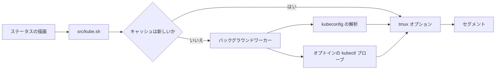

<div align="center">

# tmux-kube-revamped

<strong>現在の Kubernetes コンテキストと名前空間を、kubectl を使わずに kubeconfig から解析して tmux のステータスバーに表示します。</strong>

[English](README.md) &nbsp;|&nbsp; 日本語 &nbsp;|&nbsp; [简体中文](README.zh-Hans.md) &nbsp;|&nbsp; [繁體中文（香港）](README.zh-HK.md)

[](https://github.com/tmux-revamped/tmux-kube-revamped/actions/workflows/tests.yml)
[](LICENSE)
[](CHANGELOG.md)

<p align="center">
  <a href="#できること">できること</a> &nbsp;|&nbsp;
  <a href="#動作要件">動作要件</a> &nbsp;|&nbsp;
  <a href="#インストール">インストール</a> &nbsp;|&nbsp;
  <a href="#使い方">使い方</a> &nbsp;|&nbsp;
  <a href="#設定">設定</a> &nbsp;|&nbsp;
  <a href="#キーバインド">キーバインド</a> &nbsp;|&nbsp;
  <a href="#仕組み">仕組み</a> &nbsp;|&nbsp;
  <a href="#開発">開発</a>
</p>

</div>

ステータス用プレースホルダーが **3** 個、切り替えメニューが **2** 個と k9s ポップアップがあり、既定のセグメントは kubectl を一度も起動しません。

---

## できること

ステータスラインに `#{kube}` を置くと、`prod-ctx:web` のように現在のコンテキストと名前空間が表示されます。プラグインは awk で kubeconfig を解析するため、kubectl がインストールされていないホストでもセグメントは動作します。

| プレースホルダー | 出力 |
|:------------|:-------|
| `#{kube}` | 装飾付きのセグメント。コンテキスト、任意の `@cluster`、`:namespace`、任意のユーザー、有効なヘルスバッジを含みます |
| `#{kube_context}` | 現在のコンテキスト名のみ |
| `#{kube_namespace}` | 現在の名前空間のみ。コンテキストが名前空間を指定していない場合は `default` |

現在のコンテキストが設定されていない場合、セグメントは空になります。kubeconfig のどのエントリにも一致しない現在のコンテキストは、名前空間の代わりに `@kube_revamped_warn_icon` を後ろに付け、`@kube_revamped_warn_color` で表示されます。

ヘルスバッジは 3 種類あり、それぞれクラスターを呼び出すため、すべてオプトインです。

| バッジ | プローブ | 表示内容 |
|:------|:------|:------|
| 到達性 | `kubectl cluster-info` | 応答があれば緑の `o`、なければ赤の `x` |
| ノード | `kubectl get nodes` | `3/3` のように準備完了数と総数。すべて準備完了なら緑、そうでなければ警告色 |
| Pod | 現在の名前空間での `kubectl get pods` | 警告色の `!N`。N は `Running` でも `Completed` でもない Pod の数で、0 のときは非表示 |

## 動作要件

| 要件 | バージョンまたは備考 |
|:------------|:----------------|
| tmux | 3.2 以降 |
| bash | 3.2 以降。macOS の `/bin/bash` で動作します |
| kubeconfig | `$KUBECONFIG` に含まれるすべてのファイル。未設定の場合は `~/.kube/config` |
| kubectl、任意 | 切り替えメニューとヘルスバッジに必要です |
| [k9s](https://k9scli.io)、任意 | ポップアップに必要です。`@kube_revamped_popup_command` に設定した任意のコマンドも使えます |

CI は、GNU coreutils と uutils coreutils を使う Linux x86_64 と arm64、およびシステムの BSD ツール、GNU coreutils、uutils coreutils を使う macOS の Apple Silicon と Intel でテストスイートを実行します。

## インストール

[TPM](https://github.com/tmux-plugins/tpm) を使う場合は、`~/.tmux.conf` にプラグインを追加して `prefix + I` を押します。

```tmux
set -g @plugin 'tmux-revamped/tmux-kube-revamped'
```

TPM を使わない場合は、リポジトリをクローンし、`~/.tmux.conf` からエントリポイントを実行します。

```sh
git clone https://github.com/tmux-revamped/tmux-kube-revamped ~/.tmux/plugins/tmux-kube-revamped
```

```tmux
run-shell ~/.tmux/plugins/tmux-kube-revamped/kube-revamped.tmux
```

エントリポイントは実行時に `status-left` と `status-right` の 2 つのオプション内のプレースホルダーを置き換えるため、これらはプラグインを読み込む前に設定してください。

## 使い方

```tmux
set -g status-right '#{kube} | %H:%M'
set -g @kube_revamped_prod_pattern 'prod'
set -g @kube_revamped_probe_reach '1'
```

`prefix + M-k` を押すと、kubeconfig にあるすべてのコンテキストのメニューが開きます。1 つを選ぶと `kubectl config use-context` が実行され、キャッシュがすぐに更新されます。名前空間メニューと k9s ポップアップは、それぞれにキーを割り当てるまでバインドされません。

```tmux
set -g @kube_revamped_menu_namespace_key 'M-n'
set -g @kube_revamped_popup_key 'K'
```

名前空間メニューはキーを押した時点でクラスターに名前空間を問い合わせるため、kubectl が応答するか、2 秒のリクエストタイムアウトが過ぎた後に開きます。1 つを選ぶと `kubectl config set-context --current --namespace` が実行されます。ポップアップは、キャッシュされたコンテキストに対して `k9s --context <context> --namespace <namespace>` を実行します。

`src/kube.sh doctor` は、kubectl と k9s がインストールされているか、各 kubeconfig ファイルが読み取れるか、現在のコンテキストが kubeconfig に存在しないかを表示します。

## 設定

| オプション | 既定値 | 意味 |
|:-------|:--------|:--------|
| `@kube_revamped_interval` | `10` | キャッシュしたコンテキストが有効な秒数 |
| `@kube_revamped_icon` | 空 | コンテキストの前に表示するテキスト。Nerd Font のグリフなど |
| `@kube_revamped_color` | `#[fg=blue]` | セグメントのスタイル |
| `@kube_revamped_show_namespace` | `1` | `0` にすると `:namespace` を付けずにコンテキストを表示します |
| `@kube_revamped_hide_default` | `0` | `1` にするとコンテキスト名が `default` のときに `#{kube}` を非表示にします |
| `@kube_revamped_show_cluster` | `0` | `1` にするとコンテキストの後ろに `@cluster` を付けます |
| `@kube_revamped_show_user` | `0` | `1` にするとセグメントの後ろに ` (user)` を付けます |
| `@kube_revamped_prod_pattern` | 空 | コンテキストを本番環境とみなす部分文字列 |
| `@kube_revamped_prod_color` | `#[fg=red]` | コンテキストに本番パターンが含まれるときのセグメントのスタイル |
| `@kube_revamped_warn_color` | `#[fg=yellow]` | 存在しないコンテキストと異常のあるバッジのスタイル |
| `@kube_revamped_warn_icon` | `?` | kubeconfig に存在しないコンテキストの後ろに付ける印 |
| `@kube_revamped_menu_context_key` | `M-k` | コンテキストメニューのキー。`off` にするとバインドしません |
| `@kube_revamped_menu_namespace_key` | 空 | 名前空間メニューのキー |
| `@kube_revamped_popup_key` | 空 | ポップアップのキー |
| `@kube_revamped_popup_command` | `k9s` | ポップアップで実行するコマンド。後ろに `--context` と `--namespace` が付きます |
| `@kube_revamped_popup_width` | `80%` | ポップアップの幅 |
| `@kube_revamped_popup_height` | `80%` | ポップアップの高さ |
| `@kube_revamped_probe_reach` | `0` | `1` にすると到達性バッジを有効にします |
| `@kube_revamped_probe_nodes` | `0` | `1` にするとノードバッジを有効にします |
| `@kube_revamped_probe_pods` | `0` | `1` にすると Pod バッジを有効にします |

### 内部状態

以下のオプションはプラグインが自ら管理します。設定しないでください。

| オプション | 保持する内容 |
|:-------|:------|
| `@kube_revamped_value` | キャッシュされた `context\|namespace` の組 |
| `@kube_revamped_dangling` | 現在のコンテキストが kubeconfig に存在しないときに `1` |
| `@kube_revamped_cluster` | 現在のコンテキストのクラスター |
| `@kube_revamped_user` | 現在のコンテキストのユーザー |
| `@kube_revamped_reach` | 到達性プローブの結果 `up` または `down` |
| `@kube_revamped_nodes` | ノードプローブによる準備完了ノード数と総数 |
| `@kube_revamped_pods` | 実行中でも完了済みでもない Pod の数 |
| `@kube_revamped_value_lock` | バックグラウンド更新の実行中は `1` |

それぞれに `@kube_revamped_value_ts` のような `_ts` 付きのオプションがあり、書き込まれた時刻を Unix 時間で保持します。

## キーバインド

| キー | 動作 | 既定 |
|:----|:-------|:--------|
| `prefix + M-k` | コンテキストメニュー | バインド済み |
| `@kube_revamped_menu_namespace_key` | 名前空間メニュー | 未バインド |
| `@kube_revamped_popup_key` | k9s ポップアップ | 未バインド |

`M-k` は、ファミリーのキー割り当てでこのプラグインに与えられた枠です。バージョン 2.0.0 より前は、コンテキストメニューに既定のキーはありませんでした。バインドしないままにするには次のように設定します。

```tmux
set -g @kube_revamped_menu_context_key 'off'
```

## 仕組み



エントリポイント [`kube-revamped.tmux`](kube-revamped.tmux) は、`status-left` と `status-right` の各プレースホルダーを [`src/kube.sh`](src/kube.sh) を呼ぶ `#()` に置き換え、その後キーをバインドします。各呼び出しは tmux サーバーオプションからキャッシュを読みます。キャッシュが `@kube_revamped_interval` より古い場合、呼び出しは切り離されたワーカーを起動してすぐに戻るため、描画が待たされることはなく、一時ファイルも書き込まれません。

ワーカーは `$KUBECONFIG` のすべてのファイルを順に読み、kubectl と同じく最初に見つかった `current-context` を採用し、[`src/lib/kube/kube.sh`](src/lib/kube/kube.sh) で `contexts:` の一覧を解析します。[`src/lib/kube/cluster.sh`](src/lib/kube/cluster.sh) の各 kubectl プローブは、対応するオプションが `1` のときだけ、2 秒のリクエストタイムアウトと 5 秒の絶対制限付きで実行されます。コンテキスト名と名前空間名は、メニュー、ポップアップ、キーバインドに渡る前にシェル用にクォートされ、`#` が二重化されます。

## 開発

| コマンド | 実行内容 |
|:--------|:-------------|
| `make test` | [`test/`](test) 以下の bats スイート |
| `make lint` | すべてのシェルファイルと [`family/bin/`](family/bin) に対する warning 重大度の shellcheck |
| `make coverage` | Linux での kcov による行カバレッジ。95% 未満で失敗します |

kubeconfig パーサーとバッジの描画処理は、フィクスチャのテキストでテストされる純粋関数です。kubectl と tmux は小さなラッパーの裏にあるため、テストにクラスターは不要です。

## ライセンス

[MIT](LICENSE)、copyright Gustavo Franco.

<!-- family:begin -->

## tmux-revamped ファミリー

このプラグインは tmux-revamped ファミリーの一員です。すべてのメンバーが [`FAMILY.md`](FAMILY.md) にある同じ規約、`family/` 以下の同じツール、同じ共有ライブラリを持ち、それらはチェックサムのマニフェストでバイト単位まで同一に保たれています。メンバーは一緒にインストールする前提で作られており、ほかのメンバーが使うキーや tmux オプションを使うメンバーはありません。

1 つのメンバーで見つかった不具合は、修正完了とする前にすべてのメンバーで探します。この義務は記憶に頼らず規約に書かれており、`family/bin/sweep` がそれを果たす手段です。

| メンバー | 内容 |
|---|---|
| [`tmux-autoreload-revamped`](https://github.com/tmux-revamped/tmux-autoreload-revamped) | tmuxの設定を編集して保存するだけで、キーもコマンドも使わずに自動で再読み込みされます |
| [`tmux-battery-revamped`](https://github.com/tmux-revamped/tmux-battery-revamped) | tmux のステータスバーにバッテリーの状態を表示し、描画を妨げません |
| [`tmux-bluetooth-revamped`](https://github.com/tmux-revamped/tmux-bluetooth-revamped) | 接続中のすべての Bluetooth デバイスとそのバッテリーを tmux のステータスバーに表示し、描画を妨げません |
| [`tmux-cpu-revamped`](https://github.com/tmux-revamped/tmux-cpu-revamped) | CPU の負荷、温度、周波数を tmux のステータスバーに表示し、描画を妨げません |
| [`tmux-disk-revamped`](https://github.com/tmux-revamped/tmux-disk-revamped) | tmux のステータスバーにディスク使用量を表示し、描画を妨げません |
| [`tmux-extract-revamped`](https://github.com/tmux-revamped/tmux-extract-revamped) | 画面上の URL、パス、ハッシュなどのトークンを fzf で選び、カーソル位置に入力します。純粋なシェルだけで動きます |
| [`tmux-fzf-revamped`](https://github.com/tmux-revamped/tmux-fzf-revamped) | ポップアップ内の fzf ピッカーから、tmux のセッション、ウィンドウ、ペインの切り替え、終了、名前変更、作成を行います |
| [`tmux-git-revamped`](https://github.com/tmux-revamped/tmux-git-revamped) | アクティブなペインのgitブランチ、変更、プロバイダーの件数を、描画を止めずにtmuxのステータスバーに表示します |
| [`tmux-gpu-revamped`](https://github.com/tmux-revamped/tmux-gpu-revamped) | NVIDIA、AMD、Intel、Apple の GPU の負荷、温度、クロック、電力、メモリを tmux のステータスバーに表示します |
| [`tmux-kube-revamped`](https://github.com/tmux-revamped/tmux-kube-revamped) | **このプラグイン**、現在の Kubernetes コンテキストと名前空間を、kubectl を使わずに kubeconfig から解析して tmux のステータスバーに表示します |
| [`tmux-launcher-revamped`](https://github.com/tmux-revamped/tmux-launcher-revamped) | 任意の TUI アプリを、現在のペインのディレクトリでポップアップまたはウィンドウとして起動します。アプリごとにキーを設定できます |
| [`tmux-logging-revamped`](https://github.com/tmux-revamped/tmux-logging-revamped) | 任意のペインをファイルに保存します。ライブのログ記録、スクロールバック全体、1 回限りのスクリーンショットに対応します |
| [`tmux-music-revamped`](https://github.com/tmux-revamped/tmux-music-revamped) | 再生中の曲をステータスバーに表示し、ステータスの描画を止めません |
| [`tmux-network-revamped`](https://github.com/tmux-revamped/tmux-network-revamped) | ネットワークのスループットをステータスバーに表示し、描画を止めません |
| [`tmux-pain-control-revamped`](https://github.com/tmux-revamped/tmux-pain-control-revamped) | tmux の標準的なペインとウィンドウの操作キー。tmux のバージョンに対応し、vim と共存でき、すべて設定できます |
| [`tmux-persist-revamped`](https://github.com/tmux-revamped/tmux-persist-revamped) | tmux のすべてのセッション、ウィンドウ、ペインを保存し、タイマーで自動保存し、再起動後にすべて復元します |
| [`tmux-plugin-template`](https://github.com/tmux-revamped/tmux-plugin-template) | 描画を妨げない tmux ステータスプラグインを作るためのテンプレート |
| [`tmux-pomodoro-revamped`](https://github.com/tmux-revamped/tmux-pomodoro-revamped) | tmux のステータスバーに表示するポモドーロタイマー。状態はすべて tmux オプションに保存し、一時ファイルは使いません |
| [`tmux-ram-revamped`](https://github.com/tmux-revamped/tmux-ram-revamped) | RAM、スワップ、メモリ圧迫を tmux のステータスバーに表示します。取得はバックグラウンドで行うため、描画が待つことはありません |
| [`tmux-reorder-revamped`](https://github.com/tmux-revamped/tmux-reorder-revamped) | tmux のステータスバー上でウィンドウタブをマウスでドラッグして、そのウィンドウを移動します |
| [`tmux-scroll-revamped`](https://github.com/tmux-revamped/tmux-scroll-revamped) | 自分でスクロールするアプリにはマウスホイールをそのまま送り、それ以外では tmux のコピーモードに入ります |
| [`tmux-sensible-revamped`](https://github.com/tmux-revamped/tmux-sensible-revamped) | tmux のバージョンと端末に応じて適用する実用的な既定値。自分で設定したオプションには手を触れません |
| [`tmux-tiling-revamped`](https://github.com/tmux-revamped/tmux-tiling-revamped) | tmux 用の BSP タイリングウィンドウ管理。8 種類のレイアウト、19 種類の操作、依存関係なし |
| [`tmux-time-revamped`](https://github.com/tmux-revamped/tmux-time-revamped) | tmux のステータスバー用の現地時計と世界時計。時間帯で色分けし、カウントダウンと夏時間の警告もあります |
| [`tmux-weather-revamped`](https://github.com/tmux-revamped/tmux-weather-revamped) | wttr.in の天気を tmux のステータスバーに表示します。取得はバックグラウンドで行うため、ステータスラインが待つことはありません |

### インストールの確認

すべてのメンバーがディスク上にあれば、1 つのコマンドでメンバー間の衝突を報告します。

```sh
family/bin/doctor --live
```

各メンバーと実行中の tmux サーバーを読み取り、重複したキー、重複したステータスのプレースホルダー、命名規則に従わないオプション、規約バージョンが古くなったメンバーを報告します。

<!-- family:end -->
