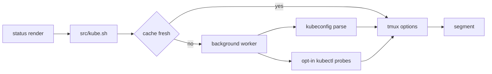

<div align="center">

# tmux-kube-revamped

<strong>Current Kubernetes context and namespace in the tmux status bar, parsed from kubeconfig without kubectl.</strong>

English &nbsp;|&nbsp; [日本語](README.ja.md) &nbsp;|&nbsp; [简体中文](README.zh-Hans.md) &nbsp;|&nbsp; [繁體中文（香港）](README.zh-HK.md)

[](https://github.com/tmux-revamped/tmux-kube-revamped/actions/workflows/tests.yml)
[](LICENSE)
[](CHANGELOG.md)

<p align="center">
  <a href="#what-it-does">What it does</a> &nbsp;|&nbsp;
  <a href="#requirements">Requirements</a> &nbsp;|&nbsp;
  <a href="#installation">Installation</a> &nbsp;|&nbsp;
  <a href="#usage">Usage</a> &nbsp;|&nbsp;
  <a href="#configuration">Configuration</a> &nbsp;|&nbsp;
  <a href="#key-bindings">Key bindings</a> &nbsp;|&nbsp;
  <a href="#how-it-works">How it works</a> &nbsp;|&nbsp;
  <a href="#development">Development</a>
</p>

</div>

**3** status placeholders, **2** switcher menus and a k9s popup, and the default segment never starts kubectl.

---

## What it does

Put `#{kube}` in your status line and it shows the current context and namespace, such as `prod-ctx:web`. The plugin parses the kubeconfig with awk, so the segment works on a host with no kubectl installed.

| Placeholder | Output |
|:------------|:-------|
| `#{kube}` | the styled segment: context, optional `@cluster`, `:namespace`, optional user, and any health badges |
| `#{kube_context}` | the current context name only |
| `#{kube_namespace}` | the current namespace only, `default` when the context sets none |

The segment is empty when no current context is set. A current context that names no entry in the kubeconfig is shown in `@kube_revamped_warn_color` with `@kube_revamped_warn_icon` after it, instead of a namespace.

Three health badges are opt-in, because each one calls the cluster:

| Badge | Probe | Shows |
|:------|:------|:------|
| reachability | `kubectl cluster-info` | a green `o` when it answers, a red `x` when it does not |
| nodes | `kubectl get nodes` | ready over total, such as `3/3`, green when all are ready and in the warning color otherwise |
| pods | `kubectl get pods` in the current namespace | `!N` in the warning color, where N counts pods neither `Running` nor `Completed`; hidden at zero |

## Requirements

| Requirement | Version or note |
|:------------|:----------------|
| tmux | 3.2 or later |
| bash | 3.2 or later, so the macOS `/bin/bash` works |
| kubeconfig | every file in `$KUBECONFIG`, or `~/.kube/config` when it is unset |
| kubectl, optional | for the switchers and the health badges |
| [k9s](https://k9scli.io), optional | for the popup, or any command set in `@kube_revamped_popup_command` |

CI runs the suite on Linux x86_64 and arm64 with GNU and uutils coreutils, and on macOS Apple Silicon and Intel with the system BSD tools, GNU coreutils and uutils coreutils.

## Installation

With [TPM](https://github.com/tmux-plugins/tpm), add the plugin to `~/.tmux.conf` and press `prefix + I`:

```tmux
set -g @plugin 'tmux-revamped/tmux-kube-revamped'
```

Without TPM, clone the repository and run the entrypoint from `~/.tmux.conf`:

```sh
git clone https://github.com/tmux-revamped/tmux-kube-revamped ~/.tmux/plugins/tmux-kube-revamped
```

```tmux
run-shell ~/.tmux/plugins/tmux-kube-revamped/kube-revamped.tmux
```

Set `status-left` or `status-right` before the plugin loads, because the entrypoint replaces the placeholders in those two options when it runs.

## Usage

```tmux
set -g status-right '#{kube} | %H:%M'
set -g @kube_revamped_prod_pattern 'prod'
set -g @kube_revamped_probe_reach '1'
```

`prefix + M-k` opens a menu of every context in the kubeconfig. Picking one runs `kubectl config use-context` and updates the cache at once. The namespace menu and the k9s popup stay unbound until you give each one a key:

```tmux
set -g @kube_revamped_menu_namespace_key 'M-n'
set -g @kube_revamped_popup_key 'K'
```

The namespace menu asks the cluster for its namespaces when you press the key, so it opens once kubectl answers or its 2-second request timeout passes. Picking one runs `kubectl config set-context --current --namespace`. The popup runs `k9s --context <context> --namespace <namespace>` for the cached context.

`src/kube.sh doctor` prints whether kubectl and k9s are installed, whether each kubeconfig file is readable, and whether the current context is missing from the kubeconfig.

## Configuration

| Option | Default | Meaning |
|:-------|:--------|:--------|
| `@kube_revamped_interval` | `10` | seconds a cached context stays fresh |
| `@kube_revamped_icon` | empty | text shown before the context, such as a Nerd Font glyph |
| `@kube_revamped_color` | `#[fg=blue]` | segment style |
| `@kube_revamped_show_namespace` | `1` | `0` shows the context without `:namespace` |
| `@kube_revamped_hide_default` | `0` | `1` hides `#{kube}` when the context is named `default` |
| `@kube_revamped_show_cluster` | `0` | `1` appends `@cluster` to the context |
| `@kube_revamped_show_user` | `0` | `1` appends ` (user)` to the segment |
| `@kube_revamped_prod_pattern` | empty | substring that marks a context as production |
| `@kube_revamped_prod_color` | `#[fg=red]` | segment style when the context contains the production pattern |
| `@kube_revamped_warn_color` | `#[fg=yellow]` | style for a missing context and for unhealthy badges |
| `@kube_revamped_warn_icon` | `?` | marker after a context missing from the kubeconfig |
| `@kube_revamped_menu_context_key` | `M-k` | key for the context menu; `off` leaves it unbound |
| `@kube_revamped_menu_namespace_key` | empty | key for the namespace menu |
| `@kube_revamped_popup_key` | empty | key for the popup |
| `@kube_revamped_popup_command` | `k9s` | command run in the popup, followed by `--context` and `--namespace` |
| `@kube_revamped_popup_width` | `80%` | popup width |
| `@kube_revamped_popup_height` | `80%` | popup height |
| `@kube_revamped_probe_reach` | `0` | `1` turns on the reachability badge |
| `@kube_revamped_probe_nodes` | `0` | `1` turns on the nodes badge |
| `@kube_revamped_probe_pods` | `0` | `1` turns on the pods badge |

### Internal state

The plugin manages these options itself. Do not set them.

| Option | Holds |
|:-------|:------|
| `@kube_revamped_value` | the cached `context\|namespace` pair |
| `@kube_revamped_dangling` | `1` when the current context is missing from the kubeconfig |
| `@kube_revamped_cluster` | the cluster of the current context |
| `@kube_revamped_user` | the user of the current context |
| `@kube_revamped_reach` | `up` or `down` from the reachability probe |
| `@kube_revamped_nodes` | ready over total nodes from the nodes probe |
| `@kube_revamped_pods` | the count of pods that are neither running nor completed |
| `@kube_revamped_value_lock` | `1` while a background refresh runs |

Each of these also has a `_ts` companion, such as `@kube_revamped_value_ts`, holding the Unix time it was written.

## Key bindings

| Key | Action | Default |
|:----|:-------|:--------|
| `prefix + M-k` | context menu | bound |
| `@kube_revamped_menu_namespace_key` | namespace menu | unbound |
| `@kube_revamped_popup_key` | k9s popup | unbound |

`M-k` is this plugin's slot in the family key allocation. Before version 2.0.0 the context menu had no default key. To leave it unbound:

```tmux
set -g @kube_revamped_menu_context_key 'off'
```

## How it works



The entrypoint [`kube-revamped.tmux`](kube-revamped.tmux) replaces each placeholder in `status-left` and `status-right` with a `#()` call to [`src/kube.sh`](src/kube.sh), then binds the keys. Each call reads the cache from tmux server options. When the cache is older than `@kube_revamped_interval`, the call starts a detached worker and returns at once, so the render never waits and no temp file is written.

The worker reads every file in `$KUBECONFIG` in order, takes the first `current-context` it finds as kubectl does, and parses the `contexts:` list in [`src/lib/kube/kube.sh`](src/lib/kube/kube.sh). Each kubectl probe in [`src/lib/kube/cluster.sh`](src/lib/kube/cluster.sh) runs only when its option is `1`, with a 2-second request timeout and a hard 5-second limit. Context and namespace names are shell-quoted and their `#` characters doubled before they reach a menu, a popup or a key binding.

## Development

| Command | What it runs |
|:--------|:-------------|
| `make test` | the bats suite under [`test/`](test) |
| `make lint` | shellcheck at warning severity on every shell file and [`family/bin/`](family/bin) |
| `make coverage` | kcov line coverage on Linux, failing below 95% |

The kubeconfig parser and the badge renderers are pure functions tested against fixture text. kubectl and tmux sit behind small wrappers, so the tests need no cluster.

## License

[MIT](LICENSE), copyright Gustavo Franco.

<!-- family:begin -->

## The tmux-revamped family

This plugin is one member of the tmux-revamped family. Every member carries the
same contract in [`FAMILY.md`](FAMILY.md), the same tooling under `family/`, and
the same shared library, all held byte-identical by a checksum manifest. They are
built to be installed together: no member claims a key or a tmux option that
another member claims.

A defect found in one member is hunted across all of them before the fix is
called done. That obligation is written into the contract rather than left to
memory, and `family/bin/sweep` is how it is discharged.

| Member | What it does |
|---|---|
| [`tmux-autoreload-revamped`](https://github.com/tmux-revamped/tmux-autoreload-revamped) | Edit your tmux config, save, and watch it reload itself, no key, no command |
| [`tmux-battery-revamped`](https://github.com/tmux-revamped/tmux-battery-revamped) | Battery status for your tmux status bar, without ever blocking the status render |
| [`tmux-bluetooth-revamped`](https://github.com/tmux-revamped/tmux-bluetooth-revamped) | Every connected Bluetooth device and its battery in your tmux status bar, without blocking the render |
| [`tmux-cpu-revamped`](https://github.com/tmux-revamped/tmux-cpu-revamped) | CPU load, temperature, and frequency in your tmux status bar, without ever blocking the render |
| [`tmux-disk-revamped`](https://github.com/tmux-revamped/tmux-disk-revamped) | Disk usage for your tmux status bar, without ever blocking the status render |
| [`tmux-extract-revamped`](https://github.com/tmux-revamped/tmux-extract-revamped) | Pick a URL, path, hash or any other token off the screen with fzf and type it at the cursor, in pure shell |
| [`tmux-fzf-revamped`](https://github.com/tmux-revamped/tmux-fzf-revamped) | Switch to, kill, rename or create tmux sessions, windows and panes from fzf pickers in a popup |
| [`tmux-git-revamped`](https://github.com/tmux-revamped/tmux-git-revamped) | Show the active pane's git branch, changes and provider counts in the tmux status bar without blocking it |
| [`tmux-gpu-revamped`](https://github.com/tmux-revamped/tmux-gpu-revamped) | GPU load, temperature, clock, power and memory in the tmux status bar, from NVIDIA, AMD, Intel and Apple GPUs |
| [`tmux-kube-revamped`](https://github.com/tmux-revamped/tmux-kube-revamped) | **this plugin**, Current Kubernetes context and namespace in the tmux status bar, parsed from kubeconfig without kubectl |
| [`tmux-launcher-revamped`](https://github.com/tmux-revamped/tmux-launcher-revamped) | Launch any TUI app in a popup or a window, scoped to the current pane's directory, with one configurable bindi |
| [`tmux-logging-revamped`](https://github.com/tmux-revamped/tmux-logging-revamped) | Capture any pane to a file: live logging, full scrollback, or a one-shot screenshot |
| [`tmux-music-revamped`](https://github.com/tmux-revamped/tmux-music-revamped) | Now playing in your tmux status bar, without ever blocking the status render |
| [`tmux-network-revamped`](https://github.com/tmux-revamped/tmux-network-revamped) | Network throughput in your tmux status bar, without ever blocking the render |
| [`tmux-pain-control-revamped`](https://github.com/tmux-revamped/tmux-pain-control-revamped) | Pane and window management bindings for tmux, version aware, vim friendly, every prefix key can be disabled |
| [`tmux-persist-revamped`](https://github.com/tmux-revamped/tmux-persist-revamped) | Save every tmux session, window and pane, auto-save on a timer, and restore it all after a reboot |
| [`tmux-plugin-template`](https://github.com/tmux-revamped/tmux-plugin-template) | The starting point for a tmux-revamped plugin: shared library, bats harness, CI and family tooling |
| [`tmux-pomodoro-revamped`](https://github.com/tmux-revamped/tmux-pomodoro-revamped) | A Pomodoro timer in the tmux status bar that keeps all of its state in tmux options, with no temp files |
| [`tmux-ram-revamped`](https://github.com/tmux-revamped/tmux-ram-revamped) | RAM, swap and memory pressure in the tmux status bar, sampled in the background so the render never waits |
| [`tmux-reorder-revamped`](https://github.com/tmux-revamped/tmux-reorder-revamped) | Drag a window tab along the tmux status bar with the mouse to move that window |
| [`tmux-scroll-revamped`](https://github.com/tmux-revamped/tmux-scroll-revamped) | Send the mouse wheel to apps that scroll themselves and into tmux copy-mode everywhere else |
| [`tmux-sensible-revamped`](https://github.com/tmux-revamped/tmux-sensible-revamped) | Sensible tmux defaults, gated by tmux version and terminal, that leave the options you set alone |
| [`tmux-tiling-revamped`](https://github.com/tmux-revamped/tmux-tiling-revamped) | Tiling window management for tmux: eight layouts including BSP dwindle and spiral, with layout undo |
| [`tmux-time-revamped`](https://github.com/tmux-revamped/tmux-time-revamped) | Local and world clocks for the tmux status bar, colored by time of day, with countdowns and a DST warning |
| [`tmux-weather-revamped`](https://github.com/tmux-revamped/tmux-weather-revamped) | Weather for the tmux status bar from wttr.in, fetched in the background so the status line never waits |

### Checking an installation

With every member on disk, one command reports any conflict between them:

```sh
family/bin/doctor --live
```

It reads each member and the running tmux server, and reports duplicate keys,
duplicate status placeholders, options outside the naming grammar, and any
member whose contract version has fallen behind.

<!-- family:end -->
