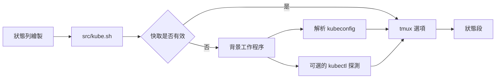

<div align="center">

# tmux-kube-revamped

<strong>在 tmux 狀態列顯示目前的 Kubernetes 上下文及命名空間，毋須 kubectl，直接解析 kubeconfig。</strong>

[English](README.md) &nbsp;|&nbsp; [日本語](README.ja.md) &nbsp;|&nbsp; [简体中文](README.zh-Hans.md) &nbsp;|&nbsp; 繁體中文（香港）

[](https://github.com/tmux-revamped/tmux-kube-revamped/actions/workflows/tests.yml)
[](LICENSE)
[](CHANGELOG.md)

<p align="center">
  <a href="#功能">功能</a> &nbsp;|&nbsp;
  <a href="#系統要求">系統要求</a> &nbsp;|&nbsp;
  <a href="#安裝">安裝</a> &nbsp;|&nbsp;
  <a href="#用法">用法</a> &nbsp;|&nbsp;
  <a href="#設定">設定</a> &nbsp;|&nbsp;
  <a href="#按鍵綁定">按鍵綁定</a> &nbsp;|&nbsp;
  <a href="#運作原理">運作原理</a> &nbsp;|&nbsp;
  <a href="#開發">開發</a>
</p>

</div>

**3** 個狀態佔位符、**2** 個切換選單及一個 k9s 彈出視窗，預設的狀態段從不啟動 kubectl。

---

## 功能

在狀態行放入 `#{kube}`，便會顯示目前的上下文及命名空間，例如 `prod-ctx:web`。插件以 awk 解析 kubeconfig，因此在沒有安裝 kubectl 的主機上，狀態段同樣可以運作。

| 佔位符 | 輸出 |
|:------------|:-------|
| `#{kube}` | 帶樣式的狀態段：上下文、可選的 `@cluster`、`:namespace`、可選的用戶，以及已啟用的健康徽章 |
| `#{kube_context}` | 只有目前的上下文名稱 |
| `#{kube_namespace}` | 只有目前的命名空間，上下文沒有設定命名空間時為 `default` |

未設定目前上下文時，狀態段為空。若目前上下文在 kubeconfig 中找不到對應項目，會以 `@kube_revamped_warn_color` 顯示，並在其後加上 `@kube_revamped_warn_icon`，而不顯示命名空間。

三個健康徽章都要自行啟用，因為每個徽章都會呼叫叢集：

| 徽章 | 探測 | 顯示內容 |
|:------|:------|:------|
| 可達性 | `kubectl cluster-info` | 有回應時顯示綠色 `o`，沒有回應時顯示紅色 `x` |
| 節點 | `kubectl get nodes` | 就緒數與總數，例如 `3/3`；全部就緒時為綠色，否則為警告色 |
| Pod | 目前命名空間中的 `kubectl get pods` | 警告色的 `!N`，N 為既非 `Running` 亦非 `Completed` 的 Pod 數目；為零時隱藏 |

## 系統要求

| 要求 | 版本或備註 |
|:------------|:----------------|
| tmux | 3.2 或以上 |
| bash | 3.2 或以上，因此 macOS 的 `/bin/bash` 可以使用 |
| kubeconfig | `$KUBECONFIG` 中的每個檔案，未設定時為 `~/.kube/config` |
| kubectl，可選 | 用於切換選單及健康徽章 |
| [k9s](https://k9scli.io)，可選 | 用於彈出視窗，亦可以是 `@kube_revamped_popup_command` 中設定的任何指令 |

CI 在使用 GNU coreutils 及 uutils coreutils 的 Linux x86_64 與 arm64 上，以及在使用系統 BSD 工具、GNU coreutils 及 uutils coreutils 的 macOS Apple Silicon 與 Intel 上執行測試套件。

## 安裝

使用 [TPM](https://github.com/tmux-plugins/tpm) 時，將插件加入 `~/.tmux.conf`，然後按 `prefix + I`：

```tmux
set -g @plugin 'tmux-revamped/tmux-kube-revamped'
```

不使用 TPM 時，複製儲存庫，並在 `~/.tmux.conf` 中執行入口腳本：

```sh
git clone https://github.com/tmux-revamped/tmux-kube-revamped ~/.tmux/plugins/tmux-kube-revamped
```

```tmux
run-shell ~/.tmux/plugins/tmux-kube-revamped/kube-revamped.tmux
```

請在插件載入之前設定 `status-left` 或 `status-right`，因為入口腳本執行時會取代這兩個選項中的佔位符。

## 用法

```tmux
set -g status-right '#{kube} | %H:%M'
set -g @kube_revamped_prod_pattern 'prod'
set -g @kube_revamped_probe_reach '1'
```

按 `prefix + M-k` 會開啟一個選單，列出 kubeconfig 中的所有上下文。選擇其中一個會執行 `kubectl config use-context`，並即時更新快取。命名空間選單及 k9s 彈出視窗在分別設定按鍵之前不會綁定：

```tmux
set -g @kube_revamped_menu_namespace_key 'M-n'
set -g @kube_revamped_popup_key 'K'
```

命名空間選單在按鍵時向叢集查詢命名空間，因此會在 kubectl 回應或 2 秒請求逾時之後才開啟。選擇其中一個會執行 `kubectl config set-context --current --namespace`。彈出視窗針對快取中的上下文執行 `k9s --context <context> --namespace <namespace>`。

`src/kube.sh doctor` 會列出 kubectl 及 k9s 是否已安裝、每個 kubeconfig 檔案是否可讀，以及目前上下文是否在 kubeconfig 中缺失。

## 設定

| 選項 | 預設值 | 意思 |
|:-------|:--------|:--------|
| `@kube_revamped_interval` | `10` | 快取的上下文維持有效的秒數 |
| `@kube_revamped_icon` | 空 | 顯示在上下文之前的文字，例如 Nerd Font 圖示 |
| `@kube_revamped_color` | `#[fg=blue]` | 狀態段樣式 |
| `@kube_revamped_show_namespace` | `1` | 設為 `0` 時顯示上下文而不帶 `:namespace` |
| `@kube_revamped_hide_default` | `0` | 設為 `1` 時，在上下文名為 `default` 時隱藏 `#{kube}` |
| `@kube_revamped_show_cluster` | `0` | 設為 `1` 時在上下文後加上 `@cluster` |
| `@kube_revamped_show_user` | `0` | 設為 `1` 時在狀態段後加上 ` (user)` |
| `@kube_revamped_prod_pattern` | 空 | 將上下文標示為正式環境的子字串 |
| `@kube_revamped_prod_color` | `#[fg=red]` | 上下文包含正式環境模式時的狀態段樣式 |
| `@kube_revamped_warn_color` | `#[fg=yellow]` | 缺失的上下文及異常徽章的樣式 |
| `@kube_revamped_warn_icon` | `?` | 加在 kubeconfig 中缺失的上下文之後的標記 |
| `@kube_revamped_menu_context_key` | `M-k` | 上下文選單的按鍵；設為 `off` 時不綁定 |
| `@kube_revamped_menu_namespace_key` | 空 | 命名空間選單的按鍵 |
| `@kube_revamped_popup_key` | 空 | 彈出視窗的按鍵 |
| `@kube_revamped_popup_command` | `k9s` | 在彈出視窗中執行的指令，其後加上 `--context` 及 `--namespace` |
| `@kube_revamped_popup_width` | `80%` | 彈出視窗闊度 |
| `@kube_revamped_popup_height` | `80%` | 彈出視窗高度 |
| `@kube_revamped_probe_reach` | `0` | 設為 `1` 時啟用可達性徽章 |
| `@kube_revamped_probe_nodes` | `0` | 設為 `1` 時啟用節點徽章 |
| `@kube_revamped_probe_pods` | `0` | 設為 `1` 時啟用 Pod 徽章 |

### 內部狀態

以下選項由插件自行管理，請勿設定。

| 選項 | 儲存內容 |
|:-------|:------|
| `@kube_revamped_value` | 快取的 `context\|namespace` 組合 |
| `@kube_revamped_dangling` | 目前上下文在 kubeconfig 中缺失時為 `1` |
| `@kube_revamped_cluster` | 目前上下文的叢集 |
| `@kube_revamped_user` | 目前上下文的用戶 |
| `@kube_revamped_reach` | 可達性探測的結果 `up` 或 `down` |
| `@kube_revamped_nodes` | 節點探測所得的就緒節點數與總數 |
| `@kube_revamped_pods` | 既非執行中亦非已完成的 Pod 數目 |
| `@kube_revamped_value_lock` | 背景更新執行期間為 `1` |

每個選項另有一個帶 `_ts` 後綴的配套選項，例如 `@kube_revamped_value_ts`，儲存寫入時的 Unix 時間。

## 按鍵綁定

| 按鍵 | 動作 | 預設 |
|:----|:-------|:--------|
| `prefix + M-k` | 上下文選單 | 已綁定 |
| `@kube_revamped_menu_namespace_key` | 命名空間選單 | 未綁定 |
| `@kube_revamped_popup_key` | k9s 彈出視窗 | 未綁定 |

`M-k` 是家族按鍵分配中分給本插件的位置。2.0.0 版之前，上下文選單沒有預設按鍵。如要保持不綁定：

```tmux
set -g @kube_revamped_menu_context_key 'off'
```

## 運作原理



入口腳本 [`kube-revamped.tmux`](kube-revamped.tmux) 將 `status-left` 及 `status-right` 中的每個佔位符取代為呼叫 [`src/kube.sh`](src/kube.sh) 的 `#()`，然後綁定按鍵。每次呼叫都從 tmux 伺服器選項讀取快取。快取比 `@kube_revamped_interval` 更舊時，呼叫會啟動一個脫離的工作程序並即時返回，因此繪製從不等待，亦不會寫入暫存檔。

工作程序按次序讀取 `$KUBECONFIG` 中的每個檔案，與 kubectl 一樣採用找到的第一個 `current-context`，並在 [`src/lib/kube/kube.sh`](src/lib/kube/kube.sh) 中解析 `contexts:` 清單。[`src/lib/kube/cluster.sh`](src/lib/kube/cluster.sh) 中的每個 kubectl 探測只會在對應選項為 `1` 時執行，並設有 2 秒請求逾時及 5 秒硬性上限。上下文及命名空間名稱在傳入選單、彈出視窗或按鍵綁定之前，會經過 shell 引號處理，並將 `#` 字元加倍。

## 開發

| 指令 | 執行內容 |
|:--------|:-------------|
| `make test` | [`test/`](test) 下的 bats 測試套件 |
| `make lint` | 對每個 shell 檔案及 [`family/bin/`](family/bin) 執行 warning 級別的 shellcheck |
| `make coverage` | 在 Linux 上以 kcov 量度行覆蓋率，低於 95% 時失敗 |

kubeconfig 解析器及徽章繪製函數都是純函數，以固定的測試文字進行測試。kubectl 及 tmux 位於小型包裝函數之後，因此測試不需要叢集。

## 授權

[MIT](LICENSE)，copyright Gustavo Franco.

<!-- family:begin -->

## tmux-revamped 插件家族

本插件是 tmux-revamped 插件家族的成員。每個成員都帶有 [`FAMILY.md`](FAMILY.md) 中的同一份約定、`family/` 下的同一套工具和同一個共用程式庫，並由校驗和清單確保逐位元組一致。這些成員可以一併安裝：任何成員都不會佔用其他成員使用的按鍵或 tmux 選項。

在一個成員中發現的缺陷，要在全部成員中排查後才算修正完成。這項責任寫在約定之中，而不是依靠記憶，`family/bin/sweep` 負責執行。

| 成員 | 功能 |
|---|---|
| [`tmux-autoreload-revamped`](https://github.com/tmux-revamped/tmux-autoreload-revamped) | 編輯並儲存 tmux 設定後，它會自動重新載入，毋須按鍵，也毋須指令 |
| [`tmux-battery-revamped`](https://github.com/tmux-revamped/tmux-battery-revamped) | 在 tmux 狀態列顯示電池狀態，從不阻塞狀態列繪製 |
| [`tmux-bluetooth-revamped`](https://github.com/tmux-revamped/tmux-bluetooth-revamped) | 在 tmux 狀態列顯示每部已連接的藍牙裝置及其電量，不阻塞繪製 |
| [`tmux-cpu-revamped`](https://github.com/tmux-revamped/tmux-cpu-revamped) | 在 tmux 狀態列顯示 CPU 負載、溫度及頻率，從不阻塞繪製 |
| [`tmux-disk-revamped`](https://github.com/tmux-revamped/tmux-disk-revamped) | 在 tmux 狀態列顯示磁碟用量，從不阻塞狀態列繪製 |
| [`tmux-extract-revamped`](https://github.com/tmux-revamped/tmux-extract-revamped) | 用 fzf 從畫面上揀選 URL、路徑、雜湊值或任何其他字詞，並輸入到游標位置，全部以純 shell 實現 |
| [`tmux-fzf-revamped`](https://github.com/tmux-revamped/tmux-fzf-revamped) | 在彈出視窗的 fzf 選擇器中切換、關閉、重新命名或建立 tmux 工作階段、視窗和窗格 |
| [`tmux-git-revamped`](https://github.com/tmux-revamped/tmux-git-revamped) | 在 tmux 狀態列顯示當前窗格的 git 分支、改動和託管平台數目，而不會阻塞顯示 |
| [`tmux-gpu-revamped`](https://github.com/tmux-revamped/tmux-gpu-revamped) | 在 tmux 狀態列顯示 NVIDIA、AMD、Intel 及 Apple GPU 的負載、溫度、時脈、功耗及記憶體 |
| [`tmux-kube-revamped`](https://github.com/tmux-revamped/tmux-kube-revamped) | **本插件**，在 tmux 狀態列顯示目前的 Kubernetes 上下文及命名空間，毋須 kubectl，直接解析 kubeconfig |
| [`tmux-launcher-revamped`](https://github.com/tmux-revamped/tmux-launcher-revamped) | 在彈出視窗或新視窗中啟動任何 TUI 應用程式，從目前窗格的目錄開始，每個應用程式可設定一個按鍵 |
| [`tmux-logging-revamped`](https://github.com/tmux-revamped/tmux-logging-revamped) | 將任何窗格儲存到檔案：即時記錄、完整捲動緩衝區或一次性截圖 |
| [`tmux-music-revamped`](https://github.com/tmux-revamped/tmux-music-revamped) | 在 tmux 狀態列顯示正在播放的歌曲，從不阻塞狀態列的繪製 |
| [`tmux-network-revamped`](https://github.com/tmux-revamped/tmux-network-revamped) | 在 tmux 狀態列顯示網絡傳輸量，從不阻塞繪製 |
| [`tmux-pain-control-revamped`](https://github.com/tmux-revamped/tmux-pain-control-revamped) | tmux 的窗格和視窗管理按鍵，配合 tmux 版本，與 vim 相容，每個 prefix 按鍵都可停用 |
| [`tmux-persist-revamped`](https://github.com/tmux-revamped/tmux-persist-revamped) | 儲存 tmux 的所有工作階段、視窗及窗格，按計時器自動儲存，並在重新開機後全部還原 |
| [`tmux-plugin-template`](https://github.com/tmux-revamped/tmux-plugin-template) | tmux-revamped 插件的起點：共用程式庫、bats 測試框架、CI 和系列工具 |
| [`tmux-pomodoro-revamped`](https://github.com/tmux-revamped/tmux-pomodoro-revamped) | tmux 狀態列中的番茄鐘計時器，所有狀態都儲存在 tmux 選項中，不使用暫存檔 |
| [`tmux-ram-revamped`](https://github.com/tmux-revamped/tmux-ram-revamped) | 在 tmux 狀態列顯示記憶體、交換空間及記憶體壓力，在背景取樣，繪製從不等待 |
| [`tmux-reorder-revamped`](https://github.com/tmux-revamped/tmux-reorder-revamped) | 用滑鼠在 tmux 狀態列上拖動視窗標籤來移動該視窗 |
| [`tmux-scroll-revamped`](https://github.com/tmux-revamped/tmux-scroll-revamped) | 將滑鼠滾輪交給能自行捲動的應用程式，其他情況下進入 tmux 複製模式 |
| [`tmux-sensible-revamped`](https://github.com/tmux-revamped/tmux-sensible-revamped) | 按 tmux 版本和終端機區分的合理預設設定，不會改動你自己設定的選項 |
| [`tmux-tiling-revamped`](https://github.com/tmux-revamped/tmux-tiling-revamped) | tmux 的平鋪視窗管理：八種版面，包括 BSP dwindle 和 spiral，並支援復原版面 |
| [`tmux-time-revamped`](https://github.com/tmux-revamped/tmux-time-revamped) | 狀態列中的本地時鐘和世界時鐘，按一天中的時段著色，並提供倒數和夏令時間提示 |
| [`tmux-weather-revamped`](https://github.com/tmux-revamped/tmux-weather-revamped) | 在背景從 wttr.in 取得天氣並顯示在狀態列，狀態列毋須等待 |

### 檢查安裝

所有成員都在磁碟上時，一個指令即可報告它們之間的任何衝突：

```sh
family/bin/doctor --live
```

它讀取每個成員和正在運行的 tmux 伺服器，報告重複的按鍵、重複的狀態佔位符、不符合命名規則的選項，以及約定版本落後的成員。

<!-- family:end -->
