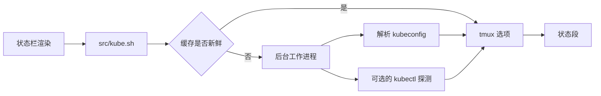

<div align="center">

# tmux-kube-revamped

<strong>在 tmux 状态栏中显示当前的 Kubernetes 上下文和命名空间，不依赖 kubectl，直接解析 kubeconfig。</strong>

[English](README.md) &nbsp;|&nbsp; [日本語](README.ja.md) &nbsp;|&nbsp; 简体中文 &nbsp;|&nbsp; [繁體中文（香港）](README.zh-HK.md)

[](https://github.com/tmux-revamped/tmux-kube-revamped/actions/workflows/tests.yml)
[](LICENSE)
[](CHANGELOG.md)

<p align="center">
  <a href="#功能">功能</a> &nbsp;|&nbsp;
  <a href="#环境要求">环境要求</a> &nbsp;|&nbsp;
  <a href="#安装">安装</a> &nbsp;|&nbsp;
  <a href="#用法">用法</a> &nbsp;|&nbsp;
  <a href="#配置">配置</a> &nbsp;|&nbsp;
  <a href="#按键绑定">按键绑定</a> &nbsp;|&nbsp;
  <a href="#工作原理">工作原理</a> &nbsp;|&nbsp;
  <a href="#开发">开发</a>
</p>

</div>

**3** 个状态占位符、**2** 个切换菜单和一个 k9s 弹出窗口，默认的状态段从不启动 kubectl。

---

## 功能

在状态行中放入 `#{kube}`，即可显示当前的上下文和命名空间，例如 `prod-ctx:web`。插件用 awk 解析 kubeconfig，因此在未安装 kubectl 的主机上，状态段同样可以工作。

| 占位符 | 输出 |
|:------------|:-------|
| `#{kube}` | 带样式的状态段：上下文、可选的 `@cluster`、`:namespace`、可选的用户，以及已启用的健康徽章 |
| `#{kube_context}` | 仅当前上下文名称 |
| `#{kube_namespace}` | 仅当前命名空间，上下文未设置命名空间时为 `default` |

未设置当前上下文时，状态段为空。如果当前上下文在 kubeconfig 中找不到对应条目，则以 `@kube_revamped_warn_color` 显示，并在其后附加 `@kube_revamped_warn_icon`，而不显示命名空间。

三个健康徽章都需要手动开启，因为每个徽章都会调用集群：

| 徽章 | 探测 | 显示内容 |
|:------|:------|:------|
| 可达性 | `kubectl cluster-info` | 有响应时显示绿色 `o`，无响应时显示红色 `x` |
| 节点 | `kubectl get nodes` | 就绪数与总数，例如 `3/3`；全部就绪时为绿色，否则为警告色 |
| Pod | 当前命名空间中的 `kubectl get pods` | 警告色的 `!N`，N 为既不是 `Running` 也不是 `Completed` 的 Pod 数；为零时隐藏 |

## 环境要求

| 要求 | 版本或说明 |
|:------------|:----------------|
| tmux | 3.2 或更高版本 |
| bash | 3.2 或更高版本，因此 macOS 的 `/bin/bash` 可以使用 |
| kubeconfig | `$KUBECONFIG` 中的每个文件，未设置时为 `~/.kube/config` |
| kubectl，可选 | 用于切换菜单和健康徽章 |
| [k9s](https://k9scli.io)，可选 | 用于弹出窗口，也可以是 `@kube_revamped_popup_command` 中设置的任意命令 |

CI 在使用 GNU coreutils 和 uutils coreutils 的 Linux x86_64 与 arm64 上，以及在使用系统 BSD 工具、GNU coreutils 和 uutils coreutils 的 macOS Apple Silicon 与 Intel 上运行测试套件。

## 安装

使用 [TPM](https://github.com/tmux-plugins/tpm) 时，将插件添加到 `~/.tmux.conf`，然后按 `prefix + I`：

```tmux
set -g @plugin 'tmux-revamped/tmux-kube-revamped'
```

不使用 TPM 时，克隆仓库并在 `~/.tmux.conf` 中运行入口脚本：

```sh
git clone https://github.com/tmux-revamped/tmux-kube-revamped ~/.tmux/plugins/tmux-kube-revamped
```

```tmux
run-shell ~/.tmux/plugins/tmux-kube-revamped/kube-revamped.tmux
```

请在插件加载之前设置 `status-left` 或 `status-right`，因为入口脚本在运行时会替换这两个选项中的占位符。

## 用法

```tmux
set -g status-right '#{kube} | %H:%M'
set -g @kube_revamped_prod_pattern 'prod'
set -g @kube_revamped_probe_reach '1'
```

按 `prefix + M-k` 会打开一个菜单，列出 kubeconfig 中的所有上下文。选择其中一个会运行 `kubectl config use-context`，并立即更新缓存。命名空间菜单和 k9s 弹出窗口在分别设置按键之前不会绑定：

```tmux
set -g @kube_revamped_menu_namespace_key 'M-n'
set -g @kube_revamped_popup_key 'K'
```

命名空间菜单在按键时向集群查询命名空间，因此会在 kubectl 响应或 2 秒请求超时之后打开。选择其中一个会运行 `kubectl config set-context --current --namespace`。弹出窗口针对缓存中的上下文运行 `k9s --context <context> --namespace <namespace>`。

`src/kube.sh doctor` 会输出 kubectl 和 k9s 是否已安装、每个 kubeconfig 文件是否可读，以及当前上下文是否在 kubeconfig 中缺失。

## 配置

| 选项 | 默认值 | 含义 |
|:-------|:--------|:--------|
| `@kube_revamped_interval` | `10` | 缓存的上下文保持有效的秒数 |
| `@kube_revamped_icon` | 空 | 显示在上下文之前的文本，例如 Nerd Font 图标 |
| `@kube_revamped_color` | `#[fg=blue]` | 状态段样式 |
| `@kube_revamped_show_namespace` | `1` | 设为 `0` 时显示上下文而不带 `:namespace` |
| `@kube_revamped_hide_default` | `0` | 设为 `1` 时，在上下文名为 `default` 时隐藏 `#{kube}` |
| `@kube_revamped_show_cluster` | `0` | 设为 `1` 时在上下文后附加 `@cluster` |
| `@kube_revamped_show_user` | `0` | 设为 `1` 时在状态段后附加 ` (user)` |
| `@kube_revamped_prod_pattern` | 空 | 将上下文标记为生产环境的子字符串 |
| `@kube_revamped_prod_color` | `#[fg=red]` | 上下文包含生产模式时的状态段样式 |
| `@kube_revamped_warn_color` | `#[fg=yellow]` | 缺失的上下文和异常徽章的样式 |
| `@kube_revamped_warn_icon` | `?` | 附加在 kubeconfig 中缺失的上下文之后的标记 |
| `@kube_revamped_menu_context_key` | `M-k` | 上下文菜单的按键；设为 `off` 时不绑定 |
| `@kube_revamped_menu_namespace_key` | 空 | 命名空间菜单的按键 |
| `@kube_revamped_popup_key` | 空 | 弹出窗口的按键 |
| `@kube_revamped_popup_command` | `k9s` | 在弹出窗口中运行的命令，其后附加 `--context` 和 `--namespace` |
| `@kube_revamped_popup_width` | `80%` | 弹出窗口宽度 |
| `@kube_revamped_popup_height` | `80%` | 弹出窗口高度 |
| `@kube_revamped_probe_reach` | `0` | 设为 `1` 时开启可达性徽章 |
| `@kube_revamped_probe_nodes` | `0` | 设为 `1` 时开启节点徽章 |
| `@kube_revamped_probe_pods` | `0` | 设为 `1` 时开启 Pod 徽章 |

### 内部状态

以下选项由插件自行管理，请勿设置。

| 选项 | 保存内容 |
|:-------|:------|
| `@kube_revamped_value` | 缓存的 `context\|namespace` 组合 |
| `@kube_revamped_dangling` | 当前上下文在 kubeconfig 中缺失时为 `1` |
| `@kube_revamped_cluster` | 当前上下文的集群 |
| `@kube_revamped_user` | 当前上下文的用户 |
| `@kube_revamped_reach` | 可达性探测的结果 `up` 或 `down` |
| `@kube_revamped_nodes` | 节点探测得到的就绪节点数与总数 |
| `@kube_revamped_pods` | 既未运行也未完成的 Pod 数 |
| `@kube_revamped_value_lock` | 后台刷新运行期间为 `1` |

每个选项还有一个带 `_ts` 后缀的配套选项，例如 `@kube_revamped_value_ts`，保存写入时的 Unix 时间。

## 按键绑定

| 按键 | 操作 | 默认 |
|:----|:-------|:--------|
| `prefix + M-k` | 上下文菜单 | 已绑定 |
| `@kube_revamped_menu_namespace_key` | 命名空间菜单 | 未绑定 |
| `@kube_revamped_popup_key` | k9s 弹出窗口 | 未绑定 |

`M-k` 是家族按键分配中分给本插件的位置。2.0.0 版本之前，上下文菜单没有默认按键。如需保持不绑定：

```tmux
set -g @kube_revamped_menu_context_key 'off'
```

## 工作原理



入口脚本 [`kube-revamped.tmux`](kube-revamped.tmux) 把 `status-left` 和 `status-right` 中的每个占位符替换为调用 [`src/kube.sh`](src/kube.sh) 的 `#()`，然后绑定按键。每次调用都从 tmux 服务器选项中读取缓存。缓存比 `@kube_revamped_interval` 更旧时，调用会启动一个脱离的工作进程并立即返回，因此渲染从不等待，也不会写入临时文件。

工作进程按顺序读取 `$KUBECONFIG` 中的每个文件，与 kubectl 一样采用找到的第一个 `current-context`，并在 [`src/lib/kube/kube.sh`](src/lib/kube/kube.sh) 中解析 `contexts:` 列表。[`src/lib/kube/cluster.sh`](src/lib/kube/cluster.sh) 中的每个 kubectl 探测仅在对应选项为 `1` 时运行，带有 2 秒请求超时和 5 秒硬性上限。上下文和命名空间名称在传入菜单、弹出窗口或按键绑定之前，会经过 shell 引用，并将 `#` 字符加倍。

## 开发

| 命令 | 运行内容 |
|:--------|:-------------|
| `make test` | [`test/`](test) 下的 bats 测试套件 |
| `make lint` | 对每个 shell 文件和 [`family/bin/`](family/bin) 运行 warning 级别的 shellcheck |
| `make coverage` | 在 Linux 上用 kcov 统计行覆盖率，低于 95% 时失败 |

kubeconfig 解析器和徽章渲染函数都是纯函数，用固定的测试文本进行测试。kubectl 和 tmux 位于小型封装函数之后，因此测试不需要集群。

## 许可证

[MIT](LICENSE)，copyright Gustavo Franco.

<!-- family:begin -->

## tmux-revamped 插件家族

本插件是 tmux-revamped 插件家族的一员。每个成员都带有 [`FAMILY.md`](FAMILY.md) 中的同一份约定、`family/` 下的同一套工具和同一个共享库，并由校验和清单保证逐字节一致。这些成员可以一起安装：任何成员都不会占用其他成员使用的按键或 tmux 选项。

在一个成员中发现的缺陷，要在全部成员中排查之后才算修复完成。这项义务写在约定里，而不是靠记忆，`family/bin/sweep` 负责执行它。

| 成员 | 功能 |
|---|---|
| [`tmux-autoreload-revamped`](https://github.com/tmux-revamped/tmux-autoreload-revamped) | 编辑并保存 tmux 配置后，它会自动重新加载，无需按键，也无需命令 |
| [`tmux-battery-revamped`](https://github.com/tmux-revamped/tmux-battery-revamped) | 在 tmux 状态栏显示电池状态，从不阻塞状态栏渲染 |
| [`tmux-bluetooth-revamped`](https://github.com/tmux-revamped/tmux-bluetooth-revamped) | 在 tmux 状态栏显示每个已连接的蓝牙设备及其电量，不阻塞渲染 |
| [`tmux-cpu-revamped`](https://github.com/tmux-revamped/tmux-cpu-revamped) | 在 tmux 状态栏显示 CPU 负载、温度和频率，从不阻塞渲染 |
| [`tmux-disk-revamped`](https://github.com/tmux-revamped/tmux-disk-revamped) | 在 tmux 状态栏显示磁盘用量，从不阻塞状态栏渲染 |
| [`tmux-extract-revamped`](https://github.com/tmux-revamped/tmux-extract-revamped) | 用 fzf 从屏幕上挑选 URL、路径、哈希或任意其他词元，并输入到光标处，全部用纯 shell 实现 |
| [`tmux-fzf-revamped`](https://github.com/tmux-revamped/tmux-fzf-revamped) | 在弹出窗口中的 fzf 选择器里切换、关闭、重命名或创建 tmux 会话、窗口和窗格 |
| [`tmux-git-revamped`](https://github.com/tmux-revamped/tmux-git-revamped) | 在 tmux 状态栏中显示活动窗格的 git 分支、改动和托管平台计数，且不阻塞渲染 |
| [`tmux-gpu-revamped`](https://github.com/tmux-revamped/tmux-gpu-revamped) | 在 tmux 状态栏中显示 NVIDIA、AMD、Intel 和 Apple GPU 的负载、温度、频率、功耗和显存 |
| [`tmux-kube-revamped`](https://github.com/tmux-revamped/tmux-kube-revamped) | **本插件**，在 tmux 状态栏中显示当前的 Kubernetes 上下文和命名空间，不依赖 kubectl，直接解析 kubeconfig |
| [`tmux-launcher-revamped`](https://github.com/tmux-revamped/tmux-launcher-revamped) | 在弹出窗口或新窗口中启动任意 TUI 应用，从当前窗格的目录开始，每个应用可配置一个按键 |
| [`tmux-logging-revamped`](https://github.com/tmux-revamped/tmux-logging-revamped) | 将任意窗格保存到文件：实时日志、完整回滚缓冲区或一次性截图 |
| [`tmux-music-revamped`](https://github.com/tmux-revamped/tmux-music-revamped) | 在 tmux 状态栏显示正在播放的曲目，从不阻塞状态栏渲染 |
| [`tmux-network-revamped`](https://github.com/tmux-revamped/tmux-network-revamped) | 在 tmux 状态栏显示网络吞吐量，从不阻塞渲染 |
| [`tmux-pain-control-revamped`](https://github.com/tmux-revamped/tmux-pain-control-revamped) | tmux 的窗格和窗口管理按键，适配 tmux 版本，兼容 vim，每个 prefix 按键都可禁用 |
| [`tmux-persist-revamped`](https://github.com/tmux-revamped/tmux-persist-revamped) | 保存 tmux 的所有会话、窗口和窗格，按定时器自动保存，并在重启后全部恢复 |
| [`tmux-plugin-template`](https://github.com/tmux-revamped/tmux-plugin-template) | tmux-revamped 插件的起点：共享库、bats 测试框架、CI 和系列工具 |
| [`tmux-pomodoro-revamped`](https://github.com/tmux-revamped/tmux-pomodoro-revamped) | tmux 状态栏中的番茄钟计时器，所有状态都保存在 tmux 选项中，不使用临时文件 |
| [`tmux-ram-revamped`](https://github.com/tmux-revamped/tmux-ram-revamped) | 在 tmux 状态栏显示内存、交换空间和内存压力，在后台采样，渲染从不等待 |
| [`tmux-reorder-revamped`](https://github.com/tmux-revamped/tmux-reorder-revamped) | 用鼠标在 tmux 状态栏上拖动窗口标签来移动该窗口 |
| [`tmux-scroll-revamped`](https://github.com/tmux-revamped/tmux-scroll-revamped) | 将鼠标滚轮交给能自行滚动的应用，其他情况下进入 tmux 复制模式 |
| [`tmux-sensible-revamped`](https://github.com/tmux-revamped/tmux-sensible-revamped) | 按 tmux 版本和终端区分的合理默认设置，不改动你自己设置的选项 |
| [`tmux-tiling-revamped`](https://github.com/tmux-revamped/tmux-tiling-revamped) | tmux 的平铺窗口管理：八种布局，包括 BSP dwindle 和 spiral，并支持撤销布局 |
| [`tmux-time-revamped`](https://github.com/tmux-revamped/tmux-time-revamped) | 状态栏中的本地时钟和世界时钟，按一天中的时段着色，并提供倒计时和夏令时提醒 |
| [`tmux-weather-revamped`](https://github.com/tmux-revamped/tmux-weather-revamped) | 在后台从 wttr.in 获取天气并显示在状态栏，状态栏无需等待 |

### 检查安装

所有成员都在磁盘上时，一条命令即可报告它们之间的任何冲突：

```sh
family/bin/doctor --live
```

它读取每个成员和正在运行的 tmux 服务器，报告重复的按键、重复的状态占位符、不符合命名规则的选项，以及约定版本落后的成员。

<!-- family:end -->
